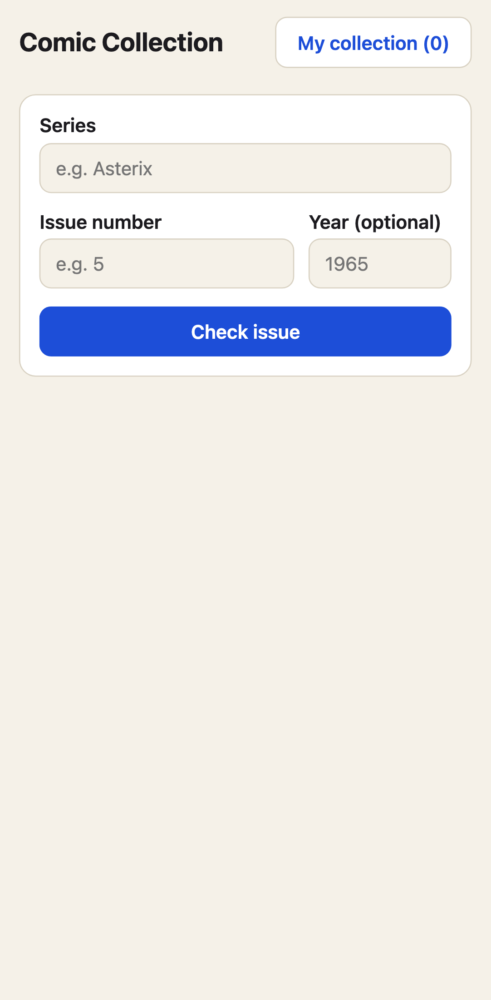
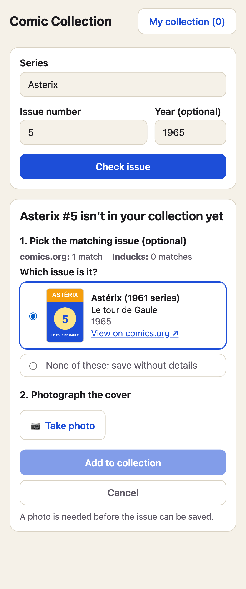

# haiku-pwa

Stress Test Haiku 5.5

A single-page Progressive Web App for keeping track of a comic book collection by issue number.

- Type a series and an issue number. The app checks your collection and tells you if you already own it.
- If you don't, it looks the issue up on [comics.org](https://www.comics.org) (Grand Comics Database) and [Inducks](https://inducks.org) (Disney comics), lets you pick the matching issue, and asks you to photograph the cover to add it.
- **My collection** lists everything you own, with your photos and links to the catalogue entries.

| Check an issue | Match found on comics.org | Already in your collection |
| --- | --- | --- |
|  |  |  |

| My collection | Inducks match | Desktop layout |
| --- | --- | --- |
|  |  |  |

## Stack

- **Frontend:** [Preact](https://preactjs.com) + [Vite](https://vite.dev), installable PWA via [vite-plugin-pwa](https://vite-pwa-org.netlify.app)
- **Backend:** Node.js + [Express 5](https://expressjs.com)
- **Database:** SQLite through Node's built-in `node:sqlite` module (no native dependencies)
- **Tests:** `node:test` for the server, [Playwright](https://playwright.dev) for end-to-end browser tests on phone and desktop profiles

## Requirements

- Node.js 22.13 or newer
- `tar` (preinstalled on macOS and Linux), used by the Inducks import
- For the browser tests only: `npx playwright install chromium`

## Getting started

```sh
npm install
npm run sync:inducks   # one-time: downloads the Inducks database (about 140 MB)
npm run build
npm start              # open http://localhost:3000
```

For development with hot reload, run `npm run dev` and open http://localhost:5173. The API runs on port 3000 and Vite proxies `/api` to it.

To install the app on a phone or use it offline, serve it over HTTPS. Browsers only allow service workers and installation from secure origins.

## How it works

1. **Check.** Enter a series and issue number (and optionally a year). The app asks the server whether that issue is already in the collection. Series names are matched ignoring case and accents, and `05` and `5` are the same issue.
2. **Owned.** If the issue is already there, the app shows your photo and its catalogue details.
3. **Not owned.** The app searches comics.org and Inducks in parallel and lists the candidates with cover art where available. Each source's status is shown, so a failing source doesn't block you. Pick the matching issue, or choose *None of these* to save it without details.
4. **Photograph.** Take a photo of the cover with your camera. The browser shrinks it to at most 1280 px before upload.
5. **Save.** The issue, the photo, and the chosen catalogue details are stored in your local database. **My collection** lists everything, and you can remove items there.

## Data sources

### comics.org (Grand Comics Database)

- Uses the public GCD API (`/api/series/name/{series}/issue/{number}/`, with the optional `/year/{year}/` filter, and `/api/issue/{id}/` for details). No account or API key is needed.
- Variant covers are skipped. Details are fetched for at most eight matches per lookup.
- Responses are cached for seven days in the collection database, so repeat lookups don't hit the service again. The service is run by volunteers, so please keep this caching in place.
- GCD data is licensed CC BY-SA 4.0. Cover images belong to their copyright holders. The app links covers back to the GCD page they came from.

### Inducks

Inducks blocks automated access to its website with a proof-of-work challenge, so the app does not scrape it. Instead, `npm run sync:inducks`:

1. downloads the official daily dump from `https://inducks.org/inducks/isv.tgz`,
2. extracts the four tables it needs (issues, publications, alternative publication names, country names), and
3. builds a read-only SQLite index in `data/inducks.sqlite`.

Re-run the sync to pick up new data. The dump is regenerated daily. Restart the server afterwards so it reopens the new index.

Inducks covers Disney comics such as Topolino and Micky Maus. Its data is available under the [Inducks licence](https://inducks.org/inducks/COPYING). Inducks pictures belong to Disney and are not shown in this app. Matches link to the Inducks issue page instead.

## Configuration

Set these as environment variables.

| Variable | Default | Purpose |
| --- | --- | --- |
| `PORT` | `3000` | HTTP port |
| `DATA_DIR` | `./data` | Where the collection database and photos are stored |
| `INDUCKS_DB_PATH` | `$DATA_DIR/inducks.sqlite` | Inducks index built by `npm run sync:inducks` |
| `COMICS_ORG_API_URL` | `https://www.comics.org/api` | comics.org API base URL |

## Where your data lives

Everything stays on the machine that runs the server.

- `data/collection.sqlite`: your collection and the comics.org response cache
- `data/photos/`: the photos you took, named by UUID
- `data/inducks.sqlite`: the Inducks index (rebuilt by the sync)
- `data/inducks-download/`: the downloaded Inducks archive (safe to delete after syncing)

Back up `data/collection.sqlite` and `data/photos/` to keep your collection.

## Testing

```sh
npm test               # server unit and API tests
npm run test:e2e       # browser tests (phone and desktop Chromium)
```

- **Unit and API tests** cover normalisation, the collection repository, the Inducks importer and search (run against a small fixture built from real Inducks rows), and the HTTP API with a fake comics.org client.
- **End-to-end tests** start a stub comics.org API (`tests/fixtures/stub-comics-org.js`) and a fresh app with the Inducks fixture. They never touch the live sites or your data. They exercise the full journey as a user: entering an issue, matching, photographing, saving, the already-owned check, listing, removing, offline reload, and installability. Screenshots of the phone run are written to `docs/screenshots/`.
- `npm run icons` regenerates the app icons, and `node tests/fixtures/make-fixture-images.mjs` regenerates the test images.

## Project layout

```
client/            Preact app (index.html, src/, public/icons/)
server/
  index.js         starts the server
  app.js           Express routes: collection, lookup, photos, static client
  collection.js    collection repository (SQLite)
  db.js            database open and schema
  cache.js         HTTP response cache
  lookup.js        merges results from both sources
  metadata/        comics.org client, Inducks search and importer
  scripts/         sync-inducks.js
tests/
  server/          node:test unit and API tests
  e2e/             Playwright specs and the test server harness
  fixtures/        stub comics.org API, Inducks fixture, test images
docs/screenshots/  screenshots used above
```

## Known limitations

- **No authentication.** Anyone who can reach the server can read and change the collection. Only expose it behind a login or on a private network.
- **Series are typed in.** There is no series catalogue. The app remembers the last series you used in the browser.
- **Offline is partial.** The app shell opens offline, but checking, matching, and the collection list need the server.
- **Matches need the sources.** If comics.org or the Inducks index is unavailable, the app says so and still lets you save the issue without details.
- **Inducks freshness depends on the sync.** Until you run `npm run sync:inducks`, Inducks matches are unavailable.
- **Photos are the only record of the cover.** Catalogue details are copied from the match you chose at save time and are not updated later.
