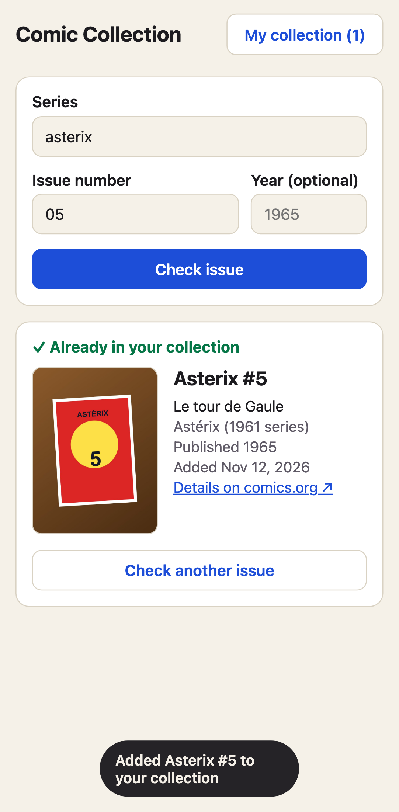
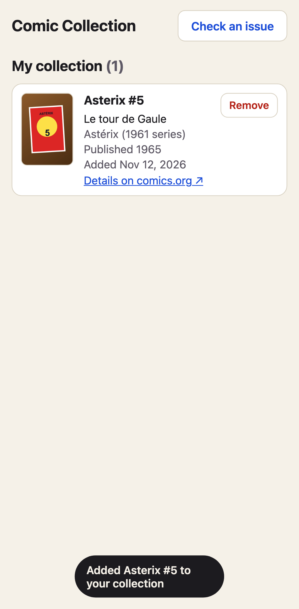
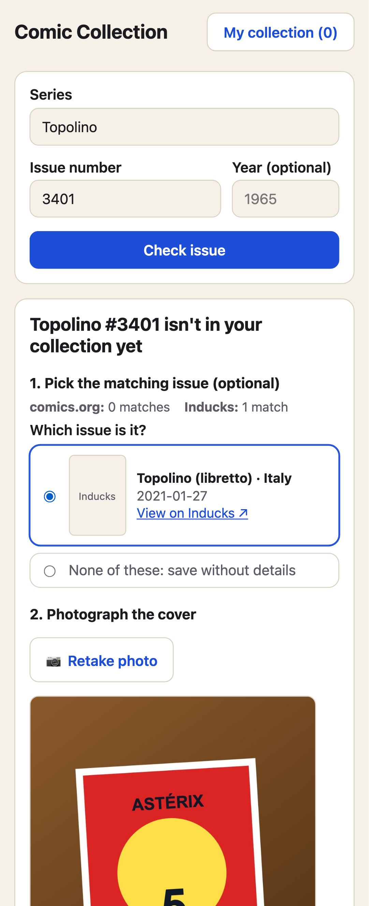
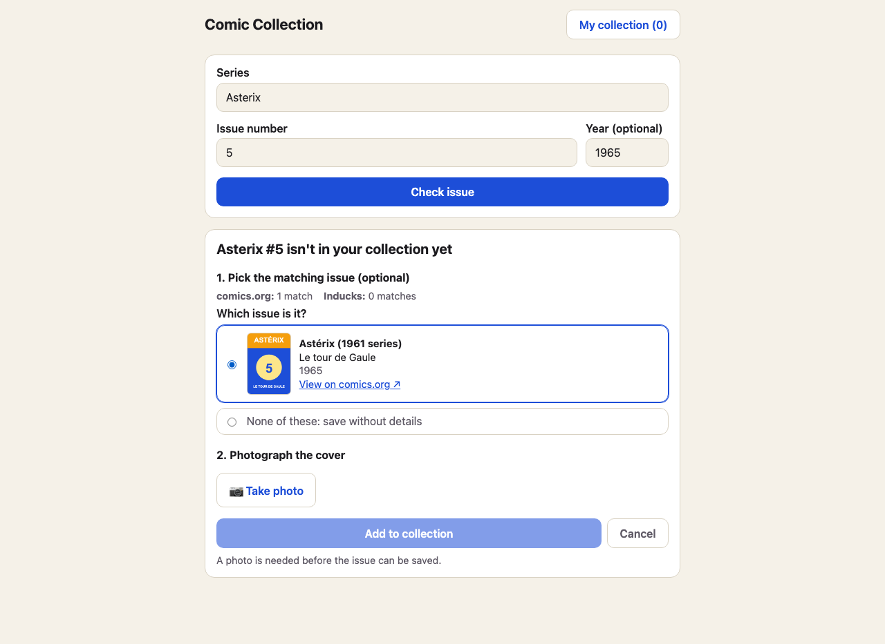

# haiku-pwa

Stress Test Haiku 5.5

A single-page Progressive Web App for keeping track of a comic book collection by issue number.

- Type a series and an issue number. The app checks your collection and tells you if you already own it.
- If you don't, it looks the issue up on [comics.org](https://www.comics.org) (Grand Comics Database) and [Inducks](https://inducks.org) (Disney comics), lets you pick the matching issue, and asks you to photograph the cover to add it.
- **My collection** lists everything you own, with your photos and links to the catalogue entries.

| Check an issue | Match found on comics.org | Already in your collection |
| --- | --- | --- |
|  |  |  |

| My collection | Inducks match | Desktop layout |
| --- | --- | --- |
|  |  |  |

## Stack

| Part | Technology |
| --- | --- |
| Server and API | Go 1.27, standard library `net/http` routing |
| Database | SQLite through [`modernc.org/sqlite`](https://pkg.go.dev/modernc.org/sqlite), pure Go (no C toolchain needed) |
| Web client | [Preact](https://preactjs.com) + [Vite](https://vite.dev), installable PWA via [vite-plugin-pwa](https://vite-pwa-org.netlify.app) |
| Tests | `go test` with the race detector; [Playwright](https://playwright.dev) for browser tests on phone and desktop profiles |
| Quality gates | `gofmt`, `go vet`, [golangci-lint](https://golangci-lint.run) v2, [govulncheck](https://go.dev/doc/security/vuln/) |
| API contract | [OpenAPI 3.1](api/openapi.yaml) |

## Requirements

- Go 1.27.4 or newer (`go.mod` pins the version; the Go toolchain downloads it automatically if needed)
- Node.js 22.12 or newer, for the web client and the browser tests
- `make` (preinstalled on macOS and Linux)
- For the browser tests only: `npx playwright install chromium`

## Getting started

```sh
npm install
make sync      # one-time: downloads the Inducks database (about 140 MB)
make run       # builds the server and the web client, then serves on http://localhost:3000
```

For development with hot reload in the browser, run `make dev` (or `npm run dev`) and open http://localhost:5173. Vite proxies `/api` to the Go server on port 3000. The Go server does not reload automatically, so restart `make dev` after changing Go code.

To install the app on a phone or use it offline, serve it over HTTPS. Browsers only allow service workers and installation from secure origins.

## How it works

1. **Check.** Enter a series and issue number (and optionally a year). The app asks the server whether that issue is already in the collection. Series names are matched ignoring case and accents, and `05` and `5` are the same issue.
2. **Owned.** If the issue is already there, the app shows your photo and its catalogue details.
3. **Not owned.** The server searches comics.org and Inducks at the same time and lists the candidates with cover art where available. Each source's status is shown, so a failing source does not block the other. Pick the matching issue, or choose *None of these* to save it without details.
4. **Photograph.** Take a photo of the cover with your camera. The browser shrinks it to at most 1280 px before upload.
5. **Save.** The issue, the photo, and the chosen catalogue details are stored locally. **My collection** lists everything, and you can remove items there.

## Data sources

### comics.org (Grand Comics Database)

- Uses the public GCD API (`/api/series/name/{series}/issue/{number}/`, with the optional `/year/{year}/` filter, and `/api/issue/{id}/` for details). No account or API key is needed.
- Variant covers are skipped. Details are fetched for at most eight matches per lookup.
- Requests are rate limited on the client side (one per second, bursts of three), and responses are cached for seven days in the collection database. The service is run by volunteers, so please keep both in place.
- If the service rate-limits the app (HTTP 429), the lookup reports that and the other source still answers.
- GCD data is licensed CC BY-SA 4.0. Cover images belong to their copyright holders. The app links covers back to the GCD page they came from.

### Inducks

Inducks blocks automated access to its website with a proof-of-work challenge, so the app does not scrape it. Instead, `make sync` (or `go run ./cmd/sync-inducks`):

1. downloads the official daily dump from `https://inducks.org/inducks/isv.tgz`,
2. extracts only the four tables it needs (issues, publications, alternative publication names, country names), and
3. builds a read-only SQLite index in `data/inducks.sqlite`, written to a temporary file and renamed into place only after a complete import.

Re-run the sync to pick up new data. The dump is regenerated daily. Restart the server afterwards so it reopens the new index.

Inducks covers Disney comics such as Topolino and Micky Maus. Its data is available under the [Inducks licence](https://inducks.org/inducks/COPYING). Inducks pictures belong to Disney and are not shown in this app. Matches link to the Inducks issue page instead.

## Configuration

Set these as environment variables.

| Variable | Default | Purpose |
| --- | --- | --- |
| `PORT` | `3000` | HTTP port |
| `DATA_DIR` | `./data` | Where the collection database and photos are stored |
| `WEB_DIR` | `./dist` | The built web client to serve |
| `INDUCKS_DB_PATH` | `$DATA_DIR/inducks.sqlite` | Inducks index built by `make sync` |
| `COMICS_ORG_API_URL` | `https://www.comics.org/api` | comics.org API base URL |
| `LOG_FORMAT` | `text` | `text` or `json` for structured logs |

Invalid values stop the server at startup with a clear message.

## Where your data lives

Everything stays on the machine that runs the server.

- `data/collection.sqlite`: your collection and the comics.org response cache
- `data/photos/`: the photos you took, named by random identifier
- `data/inducks.sqlite`: the Inducks index (rebuilt by the sync)
- `data/inducks-download/`: the downloaded Inducks archive (safe to delete after syncing)

Back up `data/collection.sqlite` and `data/photos/` to keep your collection. Schema changes are applied automatically at startup and tracked with SQLite's `user_version`.

## Testing and quality

```sh
make check     # gofmt, go vet, golangci-lint, race-enabled tests, govulncheck
make e2e       # browser tests: phone and desktop Chromium
```

- **Go tests** cover configuration, normalisation, the collection repository, photo validation, the comics.org client (against an `httptest` server), the Inducks importer and search (run against a small fixture of real Inducks rows), the lookup service, and the HTTP API end to end with a real SQLite file.
- **Browser tests** start a stub comics.org API (`tests/fixtures/stub-comics-org.js`) and the real server with the Inducks fixture. They never touch the live sites or your data. They exercise the whole user journey: entering an issue, matching, photographing, saving, the already-owned check, listing, removing, offline reload, and installability. Screenshots of the phone run are written to `docs/screenshots/`.
- `npm run icons` regenerates the app icons, and `node tests/fixtures/make-fixture-images.mjs` regenerates the test images.

CI (`.github/workflows/ci.yml`) runs the Go checks and the browser tests on every push and pull request.

## Engineering practices

The backend follows widely used Go practices:

- **Small packages with clear ownership.** `internal/` holds the implementation, so nothing is exposed as a public API by accident. Dependencies point inwards: the HTTP layer depends on the domain packages, never the other way round.
- **Explicit dependencies.** Configuration is read once from the environment and passed down. There is no global state, and sources are injected behind small interfaces.
- **Errors are values.** Errors are wrapped with context using `%w`, matched with `errors.Is` and `errors.As`, and never leak internal details to users. A failing source is reported with a message written for people.
- **Context everywhere.** Request contexts flow into database calls, outbound HTTP requests and the lookup fan-out, so a client that disconnects cancels its work.
- **Safe defaults for network services.** Server read, write, and idle timeouts; a body size limit on uploads; a client timeout and a rate limiter on outbound calls; a bounded response size on outbound reads.
- **Operational basics.** Structured logging with `log/slog` and a request ID on every response; graceful shutdown on SIGINT and SIGTERM; panic recovery that returns a JSON error; a `/api/health` endpoint.
- **Security basics.** Parameterised SQL only; photos validated by sniffing their bytes, not by trusting the declared type; catalogue URLs restricted to http and https; a restrictive Content-Security-Policy and standard security headers; a file server rooted at the web directory so requests cannot escape it.
- **Data integrity.** Migrations are forward-only and versioned. Saving an issue is one transaction that writes the photo atomically and removes it again if the commit fails. The Inducks index is built in a temporary file and only then renamed into place.
- **Tests as specifications.** Table-driven unit tests, real SQLite databases in tests instead of mocks, and browser tests that act as a user would.
- **Automated gates.** `gofmt`, `go vet`, golangci-lint with security and SQL/HTTP-specific linters, the race detector, `govulncheck` for known vulnerabilities, and the API contract in [`api/openapi.yaml`](api/openapi.yaml), linted with Redocly.

## Project layout

```
cmd/
  server/          entry point for the HTTP server
  sync-inducks/    downloads and imports the Inducks dump
internal/
  api/             HTTP routes, handlers, validation, middleware, web-client serving
  catalog/         shared types: queries, candidates, unavailable-source errors
  collection/      the collection repository and key normalisation
  comicsorg/       comics.org API client (rate limited, cached)
  config/         environment configuration
  inducks/         Inducks index search and importer
  lookup/          runs the sources concurrently and merges their results
  photo/           data-URL decoding and image validation
  store/           SQLite opening, migrations and the HTTP cache
    migrations/    versioned schema files
api/openapi.yaml   API contract
client/            Preact app (index.html, src/, public/icons/)
tests/
  e2e/             Playwright specs and the server start script
  fixtures/        stub comics.org API, Inducks fixture, test images
docs/screenshots/  screenshots used above
scripts/           icon generator
```

## Continuous integration

| Job | Steps |
| --- | --- |
| Go checks | module verification, `gofmt`, `go vet`, golangci-lint, race-enabled tests with coverage, govulncheck |
| Web client | `npm ci`, production build, Playwright Chromium, browser tests, report upload on failure |

## Known limitations

- **No authentication.** Anyone who can reach the server can read and change the collection. Only expose it behind a login or on a private network.
- **Series are typed in.** There is no series catalogue. The app remembers the last series you used in the browser.
- **Offline is partial.** The app shell opens offline, but checking, matching, and the collection list need the server.
- **Matches need the sources.** If comics.org is rate limiting or down, or the Inducks index has not been built, the app says so and still lets you save the issue without details.
- **Inducks freshness depends on the sync.** Until you run `make sync`, Inducks matches are unavailable.
- **Catalogue details are a snapshot.** They are copied from the match you chose at save time and are not updated later.
- **Standards.** The practices above follow current, widely used Go and web guidance. I have not verified them against any particular company's internal standard list.
